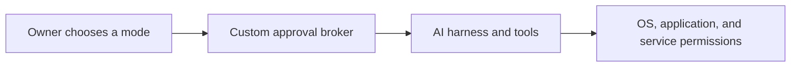

# HandsFreeBridge

**Owner-controlled approvals for AI computer tools.**

Repeated confirmation dialogs can be a real accessibility barrier. This project provides a reusable setup prompt and a small Python approval broker so people can choose how their AI tools ask permission, including an explicit no-prompt mode for their own broker.

It works alongside an AI harness and its computer-use tools. The reference implementation is macOS/Unix-oriented, with a Codex-style hook adapter and an AppleScript MCP gateway. Other integrations need verification or an adapter.

## Requirements

- Python 3.11 or newer.
- macOS or another Unix-like system. Windows is not supported yet.
- Optional: the MCP SDK and Pydantic, only needed for the AppleScript gateway import test (see [Verification](#verification)).

## Start with the prompt

Open **[prompt.md](prompt.md)** and give it to an AI coding agent you trust on a computer you own or are authorized to administer. Fill in the bracketed fields you know. The prompt tells the agent to discover the rest, inspect the actual harness, make backups, implement the supported integration, and verify it.

The prompt does not require a medical diagnosis, a particular input device, a particular AI provider, or the original developer's machine. Choose the interaction style that works for you.

## Choose the interaction

| Mode | Custom broker behavior |
| --- | --- |
| `prompt` | Requests an explicit decision for actions that need broker approval. This is the default when no policy is configured. |
| `no_prompt` | Skips this broker's per-action approval prompts for its normal tool requests, including shell commands, SSH hosts, and AppleScript. This is a broad, explicit owner choice. |



The broker changes its own approval step. Operating-system permissions, authentication, tool validation, and the user's task instructions still apply. A no-prompt setting can permit destructive operations; it does not make them harmless or authorize unrelated work.

## Try a harmless policy demonstration

On a compatible Python 3.11+ macOS/Unix environment:

```sh
python3 examples/policy_demo.py
```

Expected output:

```text
prompt: confirmation required
no_prompt: broker allows the request
No shell, SSH, or UI action was executed.
```

The demonstration uses temporary policy state and a simulated request. It does not modify your installed broker or permissions.

## What is here

- [`prompt.md`](prompt.md): an adaptable installation task for AI agents.
- [`src/`](src/): the final reference broker, policy reader, AppleScript gateway, and tests.
- [`docs/SECURITY.md`](docs/SECURITY.md): scope, privacy, and remaining platform boundaries.
- [`docs/ACCESSIBILITY.md`](docs/ACCESSIBILITY.md): interaction principles and known limits.
- [`docs/RESEARCH-2026-09-11.md`](docs/RESEARCH-2026-09-11.md): dated research behind the repository's presentation and launch plan.
- [`docs/PUBLICATION.md`](docs/PUBLICATION.md): public-copy changes, exclusions, and verification.
- [`CONTRIBUTING.md`](CONTRIBUTING.md): how to help with integrations, tests, documentation, and assistive-workflow feedback.
- [`archive/`](archive/): the redacted development record, including earlier drafts and test evidence. Its machine-specific installers and hashes are historical examples, not current installation instructions.
- [`THIRD_PARTY_NOTICES.md`](THIRD_PARTY_NOTICES.md): provenance and any material held out of the public export.

## Verification

Run the core tests from the repository root:

```sh
python3 -m unittest discover -s src -p 'test_universal_broker.py' -v
```

The full AppleScript gateway import test needs the MCP SDK and Pydantic. Without them, that test is reported as skipped. The recorded original verification used Python 3.11.14, MCP 1.6.0, and Pydantic 2.11.3; those are reproduction details, not a claim that they are the newest or recommended production versions. Have your setup agent check current compatibility before installing dependencies.

The repository has not been certified for every assistive technology, operating system, or AI harness. Windows support requires separate work. Test results describe the checks that ran, not a universal security or accessibility guarantee.

## Why contribute

Useful improvements include fewer required interactions, clearer errors, reliable voice/text approval delivery, supported harness adapters, platform tests, and documentation that people can follow without a mouse. Reports describing the interaction that failed are welcome; private medical information is not needed.

Please use issues for reproducible bugs and focused proposals. Do not post credentials, private commands, personal paths, or unredacted logs.

## License

Original HandsFreeBridge code, the setup prompt, and original documentation are available under the [Apache License 2.0](LICENSE). Copyright 2026 clockworksquirrel and contributors. Third-party material and dependencies retain their own terms; see [third-party notices](THIRD_PARTY_NOTICES.md). This license does not grant rights to linked sites or third-party trademarks.

## Project status

An experimental reference implementation and setup workflow. The original installed implementation was verified in its own environment; the public export is a separate, redacted copy. See the publication checks and archive notes for exact coverage and changes.
